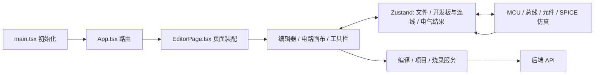

# 前端源码阅读地图

本文面向第一次阅读本仓库前端的人。先沿着“页面 → 状态 → 服务/仿真”的调用链走一遍，再按需要进入某个硬件或协议的实现。文中路径均以仓库根目录为基准；本页链接可直接打开对应源码。

## 先建立整体模型

前端是 React + TypeScript 应用，Vite 负责开发与构建，Zustand 保存工作区和运行状态。用户在编辑器里修改代码或电路；编译请求由前端服务发给后端；运行时既有浏览器内的 MCU/电路模拟，也有通过桥接层连接的 QEMU 运行环境。

这张图表示主要的阅读方向，不表示每个模块都只能按箭头通信。尤其是大型的 `useSimulatorStore`，它还负责创建和管理具体的模拟器实例。

## 文件按功能分类

| 主要模块 | 文件位置与代表入口 | 负责什么 |
| --- | --- | --- |
| 启动、路由、构建 | [main.tsx](../../frontend/src/main.tsx)、[App.tsx](../../frontend/src/App.tsx)、[vite.config.ts](../../frontend/vite.config.ts)、[entry-server.tsx](../../frontend/src/entry-server.tsx) | 初始化 i18n、主题和自定义元素；挂载 React；注册页面路由；配置 Vite、API 代理与构建时入口。`entry-server.tsx` 服务于预渲染，不是浏览器的主入口。 |
| 页面与布局 | [pages/](../../frontend/src/pages)、[EditorPage.tsx](../../frontend/src/pages/EditorPage.tsx)、[components/layout/](../../frontend/src/components/layout) | 将编辑器、画布、工具栏和底部面板组成页面；其他页面负责示例、项目链接、图片转代码等路由。 |
| 代码编辑与操作 | [components/editor/](../../frontend/src/components/editor)、[CodeEditor.tsx](../../frontend/src/components/editor/CodeEditor.tsx)、[FileExplorer.tsx](../../frontend/src/components/editor/FileExplorer.tsx)、[EditorToolbar.tsx](../../frontend/src/components/editor/EditorToolbar.tsx) | Monaco 编辑器、按开发板组织的文件树、编译/运行按钮、编译日志和进度。 |
| 电路画布与可视元件 | [components/simulator/](../../frontend/src/components/simulator)、[SimulatorCanvas.tsx](../../frontend/src/components/simulator/SimulatorCanvas.tsx)、[DynamicComponent.tsx](../../frontend/src/components/DynamicComponent.tsx)、[components/velxio-components/](../../frontend/src/components/velxio-components)、[velxio-elements/](../../frontend/src/velxio-elements) | 开发板、元件、导线及交互的可视层；把元件元数据映射到具体 Web Component。视觉表示与电气/协议行为要分别找。 |
| 工作区状态 | [store/](../../frontend/src/store)、[useEditorStore.ts](../../frontend/src/store/useEditorStore.ts)、[useSimulatorStore.ts](../../frontend/src/store/useSimulatorStore.ts)、[useElectricalStore.ts](../../frontend/src/store/useElectricalStore.ts) | 文件与当前编辑项、开发板/元件/导线及运行实例、电路求解结果；另有日志、进度、示波器、VFS 和项目身份等独立 store。 |
| 编译、烧录、后端通信 | [services/](../../frontend/src/services)、[compilation.ts](../../frontend/src/services/compilation.ts)、[flashService.ts](../../frontend/src/services/flashService.ts)、[lib/apiBase.ts](../../frontend/src/lib/apiBase.ts) | 把 UI 请求转成后端 API 调用；编译服务负责提交与轮询进度，烧录服务处理烧录流。`utils/boardCompile.ts` 准备开发板编译选项和源文件。 |
| 仿真内核 | [simulation/](../../frontend/src/simulation)、[simulation/spice/](../../frontend/src/simulation/spice)、[simulation/buses/](../../frontend/src/simulation/buses)、[simulation/parts/](../../frontend/src/simulation/parts) | MCU/桥接器、引脚与跨板连接、电气求解、I²C/SPI/UART 总线及元件行为。子目录 `customChips/`、`digital/`、`line/`、`displays/`、`ir/` 分别处理更专门的运行模型。 |
| 元件与示例数据 | [services/ComponentRegistry.ts](../../frontend/src/services/ComponentRegistry.ts)、[data/](../../frontend/src/data)、[components/examples/](../../frontend/src/components/examples)、[components/component-docs/](../../frontend/src/components/component-docs) | 元件元数据的加载/检索、示例工程定义、示例展示与元件说明。`components/customChips/` 是自定义芯片的界面和示例源码。 |
| 项目保存与加载 | [features/serverProjects/](../../frontend/src/features/serverProjects)、[utils/vlxFile.ts](../../frontend/src/utils/vlxFile.ts)、[lib/proSaveAction.ts](../../frontend/src/lib/proSaveAction.ts) | OSS 网页版的服务器项目列表与读写、可移植 `.vlx` 快照，以及“保存”动作入口。`services/projectService.ts` 还保留另一套项目 API 类型与调用，读当前 OSS 保存流程应先看 `features/serverProjects/`。 |
| 国际化与桌面适配 | [i18n/](../../frontend/src/i18n)、[desktop/](../../frontend/src/desktop)、[lib/proRoutes.ts](../../frontend/src/lib/proRoutes.ts)、[__pro_stub__/](../../frontend/src/__pro_stub__) | 语言资源与 URL 前缀、Tauri 桌面桥接，以及可选 Pro 扩展的注册入口。OSS 构建中的 `@pro` 指向空实现。 |
| 类型、工具、样式与素材 | [types/](../../frontend/src/types)、[utils/](../../frontend/src/utils)、[hooks/](../../frontend/src/hooks)、[tokens/](../../frontend/src/tokens)、[public/](../../frontend/public) | 共享数据结构、几何/布线/文件格式等纯逻辑、React hooks、设计变量与静态资源。`src/assets/` 是被源码导入的素材。 |
| 验证用代码 | `src/**/__tests__/`、`*.test.ts(x)`、[vitest.config.ts](../../frontend/vitest.config.ts) | 单元和集成测试；测试夹具、快照、固件和生成的 WASM 不是应用调用链的起点。 |

## 四条最重要的调用链

### 1. 从启动走到编辑器

浏览器入口 [main.tsx](../../frontend/src/main.tsx) 先加载 i18n、主题和 Web Components，再渲染 `App`。它还按构建标志异步挂载 Pro 扩展或桌面钩子。[App.tsx](../../frontend/src/App.tsx) 定义 OSS 路由，默认根路径进入 `/editor`；非默认语言会加语言前缀。`/editor` 最终进入 [EditorPage.tsx](../../frontend/src/pages/EditorPage.tsx)，它组合文件栏、代码编辑器、工具栏、画布、串口监视器和示波器。想知道“一个按钮为什么在这里”，先从 `EditorPage` 找它的挂载位置。

### 2. 从画布/编辑操作走到状态

[CodeEditor.tsx](../../frontend/src/components/editor/CodeEditor.tsx) 与 [FileExplorer.tsx](../../frontend/src/components/editor/FileExplorer.tsx) 围绕 [useEditorStore.ts](../../frontend/src/store/useEditorStore.ts) 的文件组和当前文件工作；一个开发板对应自己的文件组。画布 [SimulatorCanvas.tsx](../../frontend/src/components/simulator/SimulatorCanvas.tsx) 处理选择、拖放、接线等交互，再更新 [useSimulatorStore.ts](../../frontend/src/store/useSimulatorStore.ts) 中的开发板、元件和导线。元件的可视渲染可沿 `DynamicComponent` 追到 Web Component；实际行为则沿 [PartSimulationRegistry.ts](../../frontend/src/simulation/parts/PartSimulationRegistry.ts) 追到 `simulation/parts/`。

### 3. 从“编译/运行”走到后端与仿真

按钮入口在 [EditorToolbar.tsx](../../frontend/src/components/editor/EditorToolbar.tsx)：先看 `handleCompile`、`handleRun`，再读它调用的模块。常规固件编译从当前开发板的文件组取源码，经 [boardCompile.ts](../../frontend/src/utils/boardCompile.ts) 准备参数，由 [compilation.ts](../../frontend/src/services/compilation.ts) 提交后端并轮询状态，结果回写到 store，日志和进度进入各自的 store。运行前还会用电路验证检查短路等问题；随后根据开发板和语言模式选择浏览器内模拟器、MicroPython 或 QEMU 桥接。自定义芯片、无开发板电路和 Raspberry Pi 路径各有分支，不要把“运行”理解为必定先调用同一个固件编译 API。

电路求解还有一条**页面挂载时就建立**的路径：[EditorPage.tsx](../../frontend/src/pages/EditorPage.tsx) 调用 [simulation/spice/start.ts](../../frontend/src/simulation/spice/start.ts)，连接 `useSimulatorStore`、[CircuitSimulationService.ts](../../frontend/src/simulation/spice/CircuitSimulationService.ts)、[MixedModeScheduler.ts](../../frontend/src/simulation/spice/MixedModeScheduler.ts) 和 `useElectricalStore`。MCU 引脚变化触发重新求解，结果再反馈到电压、ADC、元件和仪表显示。这里的 `startSimulation()` 是电气服务的装配入口；`useSimulatorStore` 里还有面向运行状态的同名动作，阅读时要看导入来源。

### 4. 从“保存/打开”走到项目数据

页面保存按钮进入 [proSaveAction.ts](../../frontend/src/lib/proSaveAction.ts)。OSS 网页版默认走 [features/serverProjects/actions.ts](../../frontend/src/features/serverProjects/actions.ts) → `api.ts`，用 [vlxFile.ts](../../frontend/src/utils/vlxFile.ts) 将开发板、文件组、元件和连线做成项目快照；打开项目则反向加载到 store。桌面版默认下载 `.vlx`，Pro 可以注册自己的保存实现。要了解文件栏中的打开入口，可接着读已有的 [FileExplorer 专题笔记](FileExplorer.md)。

## 建议的阅读顺序

1. **第一遍只看骨架**：读 `main.tsx` → `App.tsx` → `EditorPage.tsx`，画出页面层级。先跳过 `EditorPage` 中的弹窗细节和展示逻辑；可对照已有的 [EditorPage 专题笔记](EditorPage.md)。
2. **第二遍看数据归属**：读 `types/board.ts`、`types/wire.ts`，再读 `useEditorStore` 与 `useSimulatorStore` 的状态接口和主要动作。接着看 `useElectricalStore`。先弄清“文件、开发板/连线、求解结果分别放在哪里”，再深入 5000 多行的 `useSimulatorStore` 实现。
3. **第三遍选一条用户操作追到底**：推荐“编辑代码 → 编译 → 运行”。从 `EditorToolbar` 的处理函数出发，跟到 `services/compilation.ts` 和 `useSimulatorStore` 的启动动作。边读边记下哪些分支会访问后端、哪些在浏览器内运行。
4. **第四遍看电路引擎**：从 `SimulatorCanvas` 的添加/接线动作到 store，再看 `simulation/spice/start.ts` → `CircuitSimulationService` → `MixedModeScheduler`。只有需要理解某种元件或板卡时，才进入 `simulation/parts/`、`buses/` 或具体 MCU/桥接器文件。
5. **最后按任务补专题**：项目保存看 `features/serverProjects/` 与 `vlxFile.ts`；示例看 `data/examples.ts` → `ExampleEditorPage.tsx`；新增元件看 `ComponentRegistry` → `DynamicComponent` → `PartSimulationRegistry`；语言/桌面/Pro 分别看 `i18n/`、`desktop/`、`lib/pro*`。

阅读大型文件时，先搜索 `export`、相关事件处理函数和 store 动作名，再顺着调用与类型跳转；不要按行号从头读到尾。`frontend/public/` 的素材、生成的元数据/内联 WASM、示例芯片 C 文件和测试夹具可以暂时略过。需要验证理解时，在对应模块的 `__tests__` 中找一个最小场景，比先读全部测试更快。
