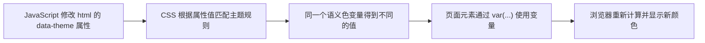

# 从空文件夹实验主题颜色切换

这篇教程用一个只有 HTML、CSS 和 JavaScript 的小网页，重现本项目主题切换的核心过程。运行页面并点击按钮，就能看到 `data-theme` 如何让组件颜色变化。

## 1. 准备实验目录

在本仓库根目录创建文件夹：

```sh
mkdir theme-lab
cd theme-lab
```

在里面创建 `index.html`、`style.css` 和 `script.js` 三个文件：

```text
theme-lab/
├── index.html
├── style.css
└── script.js
```

## 2. 写一个可以切换颜色的页面

将以下内容粘贴到 `index.html`：

```html
<!doctype html>
<html lang="zh-CN">
  <head>
    <meta charset="UTF-8" />
    <meta name="viewport" content="width=device-width, initial-scale=1" />
    <title>主题切换实验</title>
    <script>
      // 在页面显示前恢复上次选择的主题。
      try {
        const savedTheme = localStorage.getItem('demo-theme');
        document.documentElement.setAttribute(
          'data-theme',
          savedTheme === 'light' ? 'light' : 'dark'
        );
      } catch {
        document.documentElement.setAttribute('data-theme', 'dark');
      }
    </script>
    <link rel="stylesheet" href="./style.css" />
    <script src="./script.js" defer></script>
  </head>
  <body>
    <main class="card">
      <h1>主题切换实验</h1>
      <p>当前主题：<code id="current-theme"></code></p>
      <button id="toggle-theme" type="button">切换主题</button>
    </main>
  </body>
</html>
```

将以下内容粘贴到 `style.css`：

```css
/* 基础色：具体的颜色值。 */
:root {
  --gray-100: #f5f5f7;
  --gray-850: #1c1c1e;
  --gray-950: #0a0a0c;
  --white: #ffffff;
  --blue-600: #0071e3;
}

/* 语义色：颜色在页面中的用途。默认是深色主题。 */
:root {
  --color-bg-canvas: var(--gray-950);
  --color-bg-card: var(--gray-850);
  --color-fg-default: var(--gray-100);
  --color-action-primary: var(--blue-600);
}

/* <html data-theme="light"> 出现时，覆盖语义色。 */
:root[data-theme='light'] {
  --color-bg-canvas: var(--gray-100);
  --color-bg-card: var(--white);
  --color-fg-default: var(--gray-850);
}

body {
  margin: 0;
  min-height: 100vh;
  display: grid;
  place-items: center;
  font-family: Arial, sans-serif;
  background: var(--color-bg-canvas);
  color: var(--color-fg-default);
}

.card {
  padding: 32px;
  border-radius: 16px;
  background: var(--color-bg-card);
}

button {
  padding: 10px 16px;
  border: 0;
  border-radius: 8px;
  background: var(--color-action-primary);
  color: var(--white);
  cursor: pointer;
}
```

将以下内容粘贴到 `script.js`：

```js
const currentTheme = document.querySelector('#current-theme');
const toggle = document.querySelector('#toggle-theme');

function showTheme() {
  currentTheme.textContent = document.documentElement.getAttribute('data-theme');
}

toggle.addEventListener('click', () => {
  const current = document.documentElement.getAttribute('data-theme');
  const next = current === 'dark' ? 'light' : 'dark';
  document.documentElement.setAttribute('data-theme', next);
  localStorage.setItem('demo-theme', next);
  showTheme();
});

showTheme();
```

## 3. 打开网页并观察

在 `theme-lab` 目录运行：

```sh
python3 -m http.server 8000
```

浏览器打开 `http://localhost:8000`。点击“切换主题”，页面背景、卡片和文字会一起换色。打开开发者工具，查看 `<html>`：点击前后它的 `data-theme` 会在 `dark` 和 `light` 间变化。

## 4. 对照本项目

实验页面中的 `style.css` 对应 `frontend/src/tokens/colors.css`：基础色提供色值，深浅主题分别给语义色赋值。实验中的按钮处理对应 `frontend/src/components/layout/ThemeToggle.tsx` 和 `frontend/src/lib/theme.ts`，后者将最终主题写到 `<html data-theme>`，并保存用户选择。实验中 `index.html` 的前置脚本也对应本项目 `frontend/index.html` 的主题初始化代码。

本项目额外支持“跟随系统”：先根据系统偏好确定实际显示 `dark` 还是 `light`，再把这个结果写入 `data-theme`。对普通 CSS 组件来说，后面的换色过程与实验完全相同。

## 结论



组件的 CSS 写法不变；变化的是它引用的变量值。
